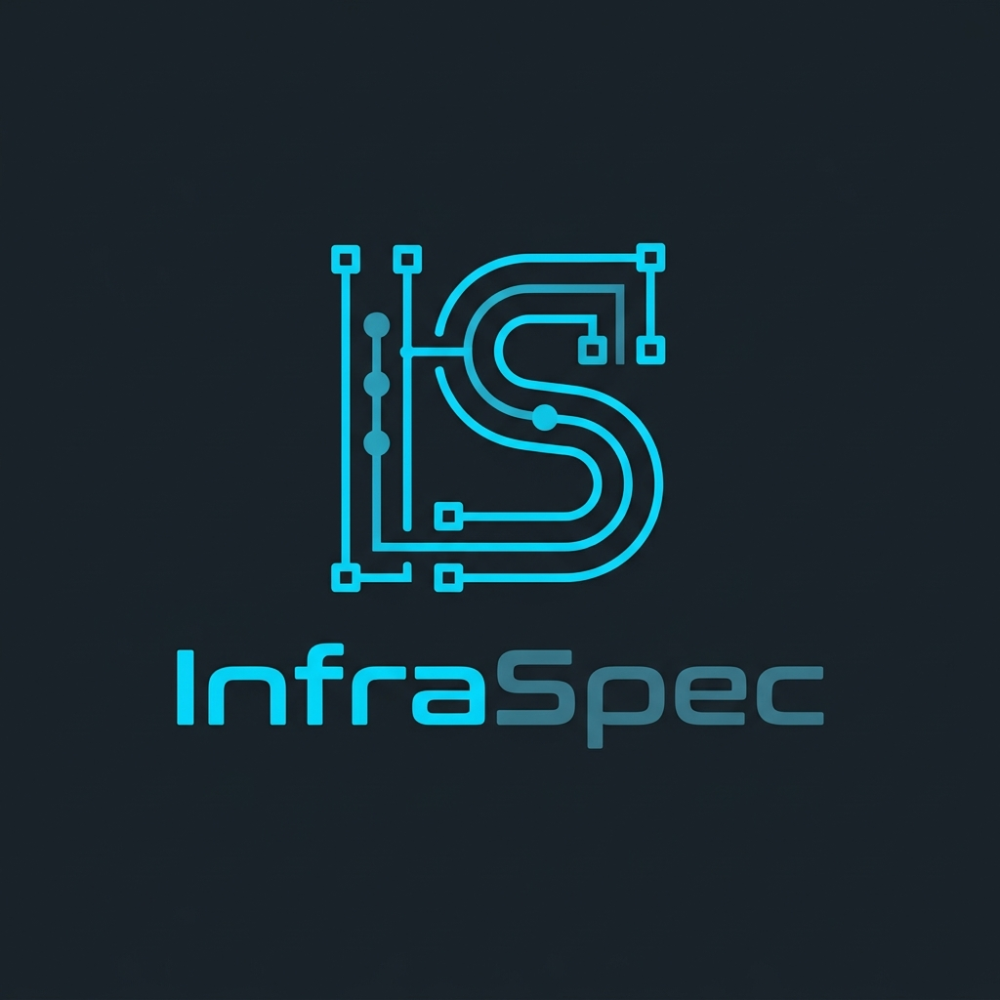

# InfraSpec v3.0 🚀
### Sistema Profissional de Especificação Técnica e Engenharia de Infraestrutura

Aplicação web client-side autônoma (Single File HTML5 + TailwindCSS + Vanilla JS) desenvolvida para engenharia de infraestrutura, cabeamento estruturado, CFTV, dimensionamento de nobreaks/energia e expansão Wi-Fi corporativo.

---

## 🛠️ Tecnologias & Arquitetura
- **Execução:** 100% no navegador (Client-Side), sem dependência de Node.js, Vercel ou bancos externos.
- **Armazenamento:** Local via `localStorage` (perfis de técnicos, múltiplos projetos e laudos históricos).
- **Estilo:** TailwindCSS com paleta personalizada inspirada no logo oficial (Dark Mode corporativo com acentos em ciano tecnológico `#00d2ff` e azul celeste).
- **Impressão:** Emissão técnica ABNT NBR 14565 / NBR 5410 com suporte nativo a folha A4 e assinaturas digitais/físicas.

---

## 📦 Módulos Integrados

1. **🌐 Cabeamento Estruturado & Redes (Engine v2.3)**
   - Dimensionamento de lances horizontais, bobinas 305m (com ajuste de puxamento mecânico simultâneo).
   - Conectores RJ45, keystones 90°/180°, espelhos 4x2, patch panels e patch cords (injetados ou montagem em campo).
   - Dimensionamento de Switches, PDUs, Guias e Racks 19" (6U a 44U).
   - Motor de Validação Térmica em Mini-Racks de parede $\le 16\text{U}$ com kit de ventilação forçada automático.

2. **📹 Montagem de Rack para Câmeras CFTV**
   - Suporte a Câmeras IP PoE (802.3af/at) e Câmeras Analógicas HD (MHD/HDCVI com Baluns).
   - Cálculo automático de Storage (HDs WD Purple / SkyHawk em TB para 15, 30 ou 60 dias de retenção contínua em H.265).
   - Switch PoE dedicado com PoE Budget ou Fonte Colmeia 12V estabilizada.
   - Caixas herméticas V Box IP66 de sobrepor, conectores BNC/P4 e NVR/DVR para rack 19".
   - Opção de vincular ao rack principal ou criar mini-rack CFTV independente com chave.

3. **⚡ Identificação & Estimativa Energética (Nobreak, DPS & Aterramento)**
   - Integração com 1 clique das cargas do módulo de cabeamento e do módulo de CFTV.
   - Cálculo da Potência Ativa (Watts) e Potência Aparente (VA) com fator de potência FP 0.7 e margem de segurança de 30%.
   - Dimensionamento de Nobreak Comercial Senoidal Puro (1.2kVA a 5kVA).
   - Estimativa de módulos de expansão de baterias externas para autonomias de 15min a 4h.
   - Protetores de surto CLAMPER Classe II (quadro/rack) e protetores de surto de rede Ethernet RJ45 PoE (linhas externas).
   - Barramento de aterramento e equipotencialização em cobre para rack 19" (NBR 5410).

4. **📶 Ampliação de Rede Wi-Fi Corporativo**
   - Dimensionamento por perfil de ambiente (Escritório, Alta Densidade, Galpão Logístico, Área Externa Outdoor IP67).
   - Padrões Wi-Fi 6 (802.11ax), Wi-Fi 6E (6 GHz) e Wi-Fi 7 (802.11be).
   - Switches PoE+ (802.3at) ou Injetores Gigabit dedicados.
   - Gestão via Cloud Controller ou Hardware Controller de rack.
   - Integração direta com os pontos de rede do cabeamento estruturado.

5. **📑 Laudo Técnico Consolidado & Gestão de Projetos**
   - Consolidação de lista técnica de materiais em tabela unificada ou por módulo.
   - Exportação em CSV, compartilhamento formatado no WhatsApp e cópia direta para a área de transferência.
   - Impressão oficial do Laudo Técnico com logotipo, identificação do contratante, responsável técnico e termos de conformidade.
   - Banco de dados local para cadastro de técnicos (Nome + Telefone) e gerenciamento de projetos.

---

## 🚀 Como Usar
Basta abrir o arquivo `index.html` em qualquer navegador web moderno (Google Chrome, Microsoft Edge, Mozilla Firefox, Brave ou Safari). Não é necessário instalar nenhum programa adicional.
